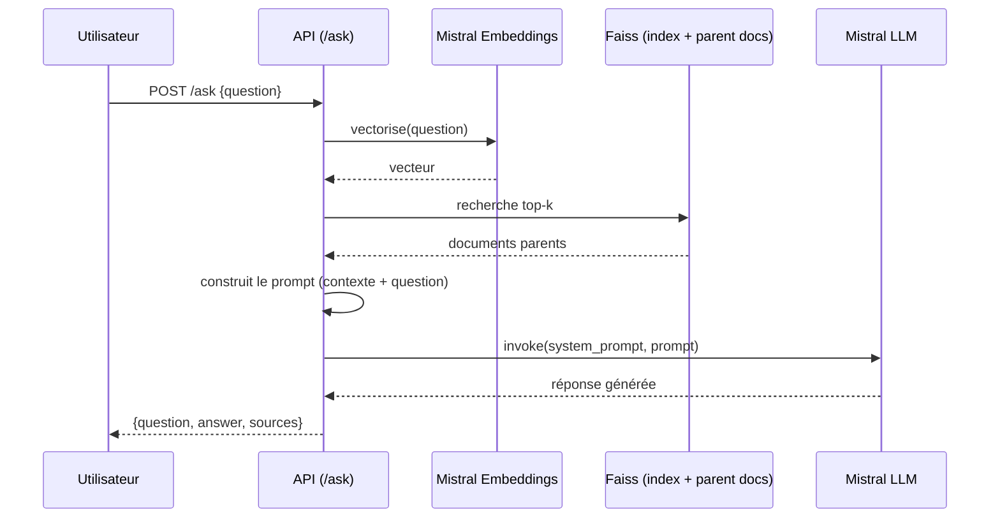

# Architecture

Le code applicatif (`src/api`) suit une architecture **ports & adapters (hexagonale)** : le cœur
métier (`use_cases.py`) ne dépend d'aucun détail technique, seulement d'interfaces (`ports.py`,
des `typing.Protocol`) que les implémentations concrètes (`infra/`) satisfont structurellement,
sans classe d'adaptation intermédiaire quand leur forme correspond déjà exactement au port.

## Pipeline d'ingestion (`POST /rebuild`)

```
            [ 📅 OPEN AGENDA API ]
                       │
                       ▼
┌──────────────────────────────────────────────┐
│        NETTOYAGE & PARSING (Docling)         │
└──────────────────────┬───────────────────────┘
                       │
                       ▼
┌──────────────────────────────────────────────┐
│             DÉCOUPAGE (Chunking)             │
└──────────────┬───────────────────────┬───────┘
               │                       │
               │ (Morceaux courts)     │ (Documents complets)
               ▼                       ▼
┌──────────────────────────────┐┌──────────────────────────────┐
│            CHUNKS            ││       PARENT DOCUMENTS       │
└──────────────┬───────────────┘└──────────────────────────────┘
               │
               ▼
┌──────────────────────────────────────────────┐
│      VECTORISATION (Mistral Embeddings)      │
└──────────────────────┬───────────────────────┘
                       │
                       ▼
┌──────────────────────────────────────────────┐
│         STOCKAGE VECTORIEL (Index FAISS)     │
└──────────────────────────────────────────────┘
```

Déclenché soit par `POST /rebuild` (via l'UI ou `make rebuild`), soit par le conteneur de seeding
lancé par `make up` (`scripts/build_index.py`) — les deux réutilisent exactement le même code
(`api.bootstrap.get_data_use_cases()`).

## Flux d'une requête `/ask` (diagramme de séquence UML)



## Rôle de chaque composant

| Couche | Fichiers | Rôle |
|---|---|---|
| **Router** | `modules/*/router.py` | Traduit HTTP ↔ use case : parsing/validation via Pydantic, appel du use case, sérialisation de la réponse. Aucune logique métier. |
| **Schemas** | `modules/*/schemas.py` | DTO Pydantic pour les requêtes/réponses HTTP (`Field(description=...)` pour la doc Swagger). Séparés des entités du domaine. |
| **Ports** | `modules/*/ports.py` | `Protocol` décrivant le contrat attendu par le use case (typage structurel — pas besoin d'héritage explicite). Décrit la forme *primitive* que l'infra expose réellement (ex. `search_parent_docs() -> list[tuple[str, str]]`), pas des types du domaine. |
| **Use cases** | `modules/*/use_cases.py` | Cœur métier : orchestre les ports, applique les règles (validation, erreurs), traduit les primitives renvoyées par l'infra en entités du domaine. **Seule couche autorisée** à importer `common/domain/entities.py` et `common/exceptions.py`. |
| **Entities / exceptions du module** | `modules/*/entities.py`, `modules/*/exceptions.py` | Types du domaine propres à un module (ex. `RAGResponse`, `EmptyQuestionError`, `DocumentNotFoundError`). |
| **Domaine partagé** | `common/domain/entities.py`, `common/exceptions.py` | Types du domaine transverses (ex. `ParentDocument`) et `DomainError`, la base commune mappée vers le bon code HTTP par un unique handler (`common/handlers.py`) — pas un handler par exception. |
| **Infra** | `infra/faiss/`, `infra/mistral/`, `infra/openagenda/`, `infra/preprocessing/` | Implémentations techniques concrètes (Faiss, Mistral, Open Agenda, Docling, chunking). Ne connaissent **jamais** les types du domaine — ne manipulent que des primitives (`str`, `int`, `tuple`, `list`). Satisfont directement les ports quand leur forme correspond déjà, sans classe d'adaptation superflue. |
| **Bootstrap** | `bootstrap.py` | Câblage manuel des dépendances (injection) : instancie l'infra et les use cases au démarrage de l'application, exposés via des fonctions `get_*_use_case()` utilisées comme dépendances FastAPI. |

Ce découpage permet par exemple à `FAISSClient` (infra) de satisfaire directement à la fois
`rag.ports.VectorSearchPort`, `documents.ports.DocumentStorePort` et `metadata.ports.IndexInfoPort`
— trois contrats différents, aucune classe d'adaptation nécessaire — tant que ses méthodes
renvoient des primitives ; c'est le use case de chaque module qui traduit ces primitives en
entités du domaine appropriées.
